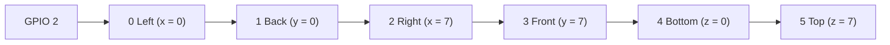
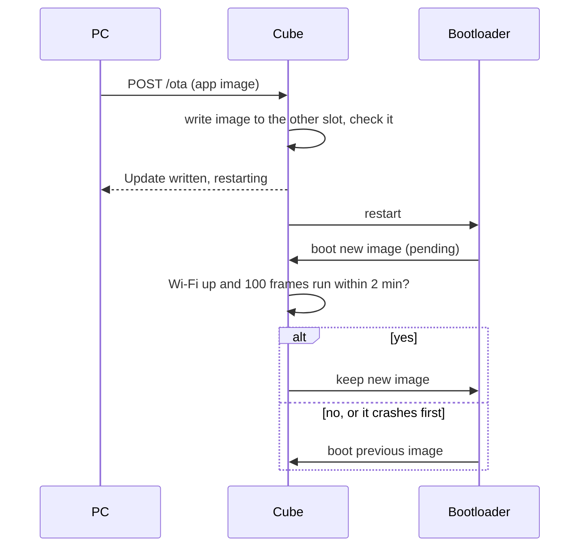
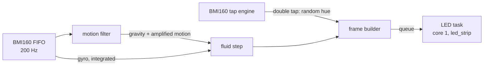

# Gravity Cube (ESP-IDF)

Firmware for an 8x8x8 LED cube whose particles fall the way the cube is
tilted. Tilt it and the fluid flows downhill; shake it and the fluid
sloshes; spin it and the fluid swirls against the spin and out to the
walls. A double tap gives the fluid a new, random colour.

It runs on an ESP32-S3 (ESP32-S3 SuperMini) with a BMI160 IMU and
six 8x8 WS2812 panels, and is written in C for ESP-IDF 6.1. The physics is
a port of the fluid solver in
[gravity-cube-rs](https://github.com/psytraxx/gravity-cube-rs).

## Hardware

| Part | Notes |
|---|---|
| ESP32-S3 SuperMini | ESP32-S3FH4R2: 4 MB flash, 2 MB PSRAM (not used) |
| BMI160 breakout | 12-pin board (VIN, 3V3, GND, SCL, SDA, CS, SA0, …), wired for SPI |
| 6 × 8x8 WS2812B panels | 384 LEDs in one chain |
| 330 Ω resistor | In series with the data line, at the first panel |
| 1500 µF capacitor | Across 5 V and GND at the first panel (10 V or more), against the inrush when the LEDs switch |
| 1N5819 Schottky diode | From the 5 V supply to the SuperMini's 5V pin, so USB cannot feed the LEDs or the supply |
| INMP441 breakout | I2S microphone, 1.8–3.3 V; wired, but the firmware does not read it |
| 5 V supply | Sized for the LEDs; the firmware keeps them dim (one channel at 60/255 or less) |

## Wiring


### Power

The 5 V supply feeds the panels directly and the SuperMini through the
1N5819, anode on the supply, cathode (the band) on the board's 5V pin.
As a Schottky it drops about 0.3 V at the board's current, so the
SuperMini's regulator gets about 4.7 V. With USB plugged in as well, the
diode keeps USB's 5 V out of the supply and the LEDs; the board then runs
from whichever is higher. The 1500 µF
capacitor sits across 5 V and GND where the supply meets the first
panel, + to 5 V. All grounds are common.

### LEDs

| SuperMini | Goes to |
|---|---|
| GPIO 2 | 330 Ω → DIN of panel 0 |

The panels are zigzag wired and chain OUT to IN. The four side panels run
round the cube: each has IN at the bottom of the edge it shares with the
previous panel, runs up the first column, down the next and so on, to OUT
at the bottom of the edge with the next one:



The per-panel rotation and mirroring is in
[`main/core/panel.c`](main/core/panel.c).

### BMI160 (SPI)

The IMU uses GPIO 10–13, the ESP32-S3's SPI2 IOMUX pins, and GPIO 9 for
its interrupt line, all on the SuperMini's header:

| BMI160 board | SuperMini |
|---|---|
| 3V3 | 3V3 |
| GND | GND |
| SCL (SCK) | GPIO 12 (SPI_CLK) |
| SDA (SDI / MOSI) | GPIO 11 (SPI_D) |
| SA0 (SDO / MISO) | GPIO 13 (SPI_Q) |
| CS (CSB) | GPIO 10 (SPI_CS) |
| INT1 | GPIO 9 |

VIN (into the board's regulator), INT2 and the auxiliary pins (OCS,
SCX, SDX) stay unconnected. INT1 is push-pull at 3.3 V, so it needs no
resistor. The chip starts on I2C; the first
rising edge on CS switches it to SPI until it is power cycled. SPI runs
at 1 MHz (the chip takes up to 10 MHz). The pins are settable in
menuconfig.

The same 12-pin board is also sold with an ST LSM6DS3 on it, and the
silkscreen does not always say which: the firmware logs `this is an ST
LSM6DS3-family chip` if it finds one, and does not drive it.

### INMP441 microphone (I2S)

| INMP441 board | SuperMini |
|---|---|
| VDD | 3V3 |
| GND | GND |
| SCK | GPIO 5 (I2S bit clock) |
| WS | GPIO 6 (I2S word select) |
| SD | GPIO 7 (I2S data) |
| L/R | GND (left channel) |

The firmware does not read the microphone. The ESP32-S3 routes I2S to any
GPIO, so these pins are just free ones next to each other on the header,
clear of the strapping pins.

### Mounting

The IMU board lies flat on the top face with its Z axis pointing up and
its X axis along the cube's x axis. Mounted any other way, edit
`BMI160_AXIS_MAP` in [`main/core/bmi160_decode.h`](main/core/bmi160_decode.h):
if tilting moves the fluid the wrong way on an axis, flip that axis' sign.

## Build and flash

ESP-IDF 6.1 ([install guide](https://docs.espressif.com/projects/esp-idf/en/v6.1/esp32s3/get-started/)):

```bash
idf.py build
idf.py -p /dev/ttyACM0 flash monitor
```

At power on, before the fluid starts, each panel in chain order (Left,
Back, Right, Front, Bottom, Top) fills green LED by LED: from the bottom
left as seen from outside, row by row, to the top right, about 0.8 s a
panel. The sides fill upright, Top and Bottom as in the unfolded cross
(Front edge at the bottom of Top, at the top of Bottom). A dark LED or
panel is dead or badly connected; if every panel from one point on stays
dark, the chain is broken at the link before the first dark one.

Keep the cube still from the end of the panel test until a second later:
the gyro calibrates its zero offset then.

The monitor logs a status line every 100 frames: acceleration,
rotation rate, and the physics, frame and LED send times.

## Updates over Wi-Fi

Once the cube has been flashed over USB with a Wi-Fi SSID set, it takes
new firmware over the network. Set the SSID and password (and, ideally,
an update token) in `idf.py menuconfig` → *Gravity cube* → *Wi-Fi and
firmware updates*, flash over USB once, then for every update:

```bash
idf.py build
curl -H "Authorization: Bearer $TOKEN" \
     --data-binary @build/gravity-cube.bin http://cube.local/ota
```

`curl http://cube.local/` shows the running version (from `git
describe`) and app slot. If `cube.local` does not resolve, use the IP
address the monitor logs once Wi-Fi is up.



The 4 MB flash has two 1984 KB app slots ([`partitions.csv`](partitions.csv)):
the running firmware writes the new image into the other one and boots
it. A new image only stays if it gets onto the network and runs the main
loop for 100 frames within two minutes; if not, or if it crashes first,
the bootloader goes back to the previous image. So a broken build cannot
cut the cube off from further updates, but one built with no SSID turns
updates off for good, until the next USB flash.

Wi-Fi, the network stack and the update server run on core 1, next to
the LED task, so the physics on core 0 keeps its time. Flash writes
pause both cores for moments at a time, so the fluid stutters for the
few seconds an update takes.

Without a token, anyone on the network can reflash the cube.

## Settings

`idf.py menuconfig` → *Gravity cube*:

| Setting | Default | |
|---|---|---|
| LED data GPIO | 2 | |
| Panel test at power on | on | Each panel fills green LED by LED, in chain order (~5 s) |
| Physics step period | 18 ms | The physics constants are per step; a fluid step takes ~17 ms, so 18 ms (55 fps) is the shortest it keeps up with |
| Tap threshold | 1000 mg | In 125 mg steps. Raise it if sloshing changes the colour, lower it if taps are missed |
| IMU SPI pins | 11, 13, 12, 10 | MOSI, MISO, SCLK, CS |
| IMU INT1 GPIO | 9 | Double-tap interrupt |
| I2C scan at startup | off | Wiring check: probes the IMU pins as I2C; finds the BMI160 at 0x68/0x69 after a power on |
| Wi-Fi SSID, password | empty | Network for updates over Wi-Fi; an empty SSID turns Wi-Fi off |
| Hostname | cube | Answers at `http://cube.local/` |
| Update token | empty | Updates need `Authorization: Bearer <token>`; empty lets anyone on the network update |

The particle count and colour are in [`main/core/config.h`](main/core/config.h).

## How it works



**Core 0** reads every IMU sample since the last frame, runs one physics
step and builds the frame. **Core 1** sends frames to the LEDs with
Espressif's [led_strip](https://components.espressif.com/components/espressif/led_strip)
component over RMT (~11.5 ms for 384 LEDs); the two overlap, and core 0 only waits if core 1
is still sending. Unchanged frames are not re-sent, so a settled cube
keeps the data line quiet.

**IMU.** The BMI160 samples accelerometer (±4 g) and gyro (±1000 °/s)
at 200 Hz into its FIFO, in headerless 12-byte frames. Each frame uses the mean acceleration and the
gyro integrated over all samples since the last frame.

**Motion filter.** A complementary filter tracks gravity: the gyro turns
the estimate as the cube tilts, and the accelerometer slowly corrects it.
Whatever acceleration is left over is the cube's own motion, and is
tripled before reaching the fluid, so shaking sloshes it but tilting does
not overshoot.

**Double tap.** The BMI160's tap engine finds them: a jump in
acceleration above the threshold, after at least 30 ms of stillness,
counts as a tap, and the 50 ms after it belong to the same tap; a second
tap within 375 ms latches a double tap and drives INT1 high. The main
loop checks the pin once a frame, and only when it is high reads and
clears the interrupt over SPI; it answers with a random hue at least 60° from the current
one. Shaking never has the stillness, so it does not
change the colour. Every hue's channels add up to 60/255, so the cube
draws the same current in any colour.

**Fluid.** An incompressible FLIP fluid: inviscid Navier-Stokes on a
staggered grid with one cell per voxel, carried by 512 particles (two per
voxel of a half-full cube). Each step the particles take gravity and the
forces of the turning cube (Euler, Coriolis, centrifugal), hand their
velocity to the grid, and a Gauss-Seidel pressure solve makes the flow
divergence-free against the walls. The particles take back the change
(80 % FLIP, 20 % PIC to damp noise), move, and are pushed apart so they
stay evenly spread; cells packed above two particles get a little
outflow, so the fluid keeps its volume. A voxel lights once the particle
density at its centre reaches 1.2 and goes dark below 0.4, so a settled
surface does not flicker. A step takes ~17 ms on the ESP32-S3.

## Enclosure

[`case/`](case/) holds the Voxel Shell enclosure: six mitred, translucent
face shells with a funnel light grid and a diffuser skin, and the USB-C
socket and slide switch on the bottom front edge.

- [`case/voxel-shell-65x65/`](case/voxel-shell-65x65/README.md) is for the
  rigid 65 x 66 mm panels; it also holds `generate.py`, which builds every
  STL, and `check_fit.py`.
- [`case/voxel-shell-80x80/`](case/voxel-shell-80x80/README.md) is for the
  flexible 80 x 80 mm panels.

`.github/workflows/pages.yml` publishes `case/` to GitHub Pages, with 3D
viewers at <https://psytraxx.github.io/gravity-cube-espidf/>.

## Code layout

| Path | |
|---|---|
| `main/main.c` | Main loop on core 0, LED task on core 1 |
| `main/ota.c` | Wi-Fi, mDNS and the update server on core 1; keeps or rolls back a new image |
| `main/bmi160.c` | BMI160 over SPI: setup, gyro calibration, FIFO reads |
| `main/ws2812.c` | WS2812 chain through the `espressif/led_strip` component (RMT) |
| `main/core/` | Everything that needs no hardware: fluid, colours, motion filter, panel map, IMU sample decoding |
| `test/host/` | Unity tests for `main/core`, run on the host |
| `case/` | Enclosure: generator, STLs and 3D viewers |

## Tests

The core has host tests (plain CMake and Unity, no ESP-IDF):

```bash
cmake -S test/host -B build-host && cmake --build build-host
ctest --test-dir build-host --output-on-failure
```

CI runs them and builds the firmware on every push.
