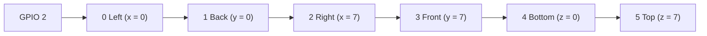
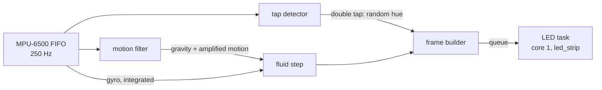

# Gravity Cube (ESP-IDF)

Firmware for an 8x8x8 LED cube whose particles fall the way the cube is
tilted. Tilt it and the fluid flows downhill; shake it and the fluid
sloshes; spin it and the fluid swirls against the spin and out to the
walls. A double tap gives the fluid a new, random colour.

It runs on an ESP32-S3 (LilyGO T-Display-S3) with an MPU-6500 IMU and
six 8x8 WS2812 panels, and is written in C for ESP-IDF 6.1. The physics is
a port of the fluid solver in
[gravity-cube-rs](https://github.com/psytraxx/gravity-cube-rs).

## Hardware

| Part | Notes |
|---|---|
| LilyGO T-Display-S3 | ESP32-S3, 16 MB flash; its LCD is not used |
| MPU-6500 breakout | 3–5 V supply (on-board LDO), wired for SPI |
| 6 × 8x8 WS2812B panels | 384 LEDs in one chain |
| 74AHCT125 | 3.3 V to 5 V level shifter for the LED data line |
| 330 Ω resistor | In series with the data line, at the first panel |
| 5 V supply | Sized for the LEDs; the firmware keeps them dim (one channel at 60/255 or less) |

## Wiring

### LEDs

| T-Display-S3 | Goes to |
|---|---|
| GPIO 2 | 74AHCT125 input → 330 Ω → DIN of panel 0 |

The panels are zigzag wired and chain OUT to IN. The four side panels run
round the cube: each has IN at the bottom of the edge it shares with the
previous panel, runs up the first column, down the next and so on, to OUT
at the bottom of the edge with the next one:



The per-panel rotation and mirroring is in
[`main/core/panel.c`](main/core/panel.c).

### MPU-6500 (SPI)

The IMU uses the board's labelled SPI header, which is clear of the LCD
pins:

| MPU-6500 board | T-Display-S3 |
|---|---|
| VCC | 3V |
| GND | GND |
| SCL (SCLK) | GPIO 12 (SPI_CLK) |
| SDA (SDI / MOSI) | GPIO 11 (SPI_D) |
| AD0 (SDO / MISO) | GPIO 13 (SPI_Q) |
| NCS | GPIO 10 (SPI_CS) |

SPI runs at 1 MHz, against 400 kHz for the board's I2C interface, so a
frame's FIFO read takes a fraction of the time. The pins are settable in
menuconfig.

### Mounting

The IMU board lies flat on the top face with its Z axis pointing up and
its X axis along the cube's x axis. Mounted any other way, edit
`MPU6500_AXIS_MAP` in [`main/core/mpu6500_decode.h`](main/core/mpu6500_decode.h):
if tilting moves the fluid the wrong way on an axis, flip that axis' sign.

## Build and flash

ESP-IDF 6.1 ([install guide](https://docs.espressif.com/projects/esp-idf/en/v6.1/esp32s3/get-started/)):

```bash
idf.py build
idf.py -p /dev/ttyACM0 flash monitor
```

At power on, each panel lights green for 2 seconds in chain order (Left,
Back, Right, Front, Bottom, Top) before the fluid starts. A dark panel
is dead or badly connected; if every panel from one point on stays dark,
the chain is broken at the link before the first dark one.

Keep the cube still from the end of the panel test until a second later:
the gyro calibrates its zero offset then.

The monitor logs a status line every 100 frames: acceleration,
rotation rate, and the physics, frame and LED send times.

## Settings

`idf.py menuconfig` → *Gravity cube*:

| Setting | Default | |
|---|---|---|
| LED data GPIO | 2 | |
| Panel test at power on | on | Each panel green for 2 s, in chain order |
| Physics step period | 18 ms | The physics constants are per step; a fluid step takes ~17 ms, so 18 ms (55 fps) is the shortest it keeps up with |
| Tap threshold | 1000 mg | Raise it if sloshing changes the colour, lower it if taps are missed |
| IMU SPI pins | 11, 13, 12, 10 | MOSI, MISO, SCLK, CS |
| I2C scan at startup | off | Wiring check: probes the IMU pins as I2C; finds the MPU-6500 at 0x68/0x69 after a power on |

The particle count and colour are in [`main/core/config.h`](main/core/config.h).

## How it works



**Core 0** reads every IMU sample since the last frame, runs one physics
step and builds the frame. **Core 1** sends frames to the LEDs with
Espressif's [led_strip](https://components.espressif.com/components/espressif/led_strip)
component over RMT (~11.5 ms for 384 LEDs); the two overlap, and core 0 only waits if core 1
is still sending. Unchanged frames are not re-sent, so a settled cube
keeps the data line quiet.

**IMU.** The MPU-6500 samples accelerometer (±4 g) and gyro (±1000 °/s)
at 250 Hz into its FIFO. Each frame uses the mean acceleration and the
gyro integrated over all samples since the last frame.

**Motion filter.** A complementary filter tracks gravity: the gyro turns
the estimate as the cube tilts, and the accelerometer slowly corrects it.
Whatever acceleration is left over is the cube's own motion, and is
tripled before reaching the fluid, so shaking sloshes it but tilting does
not overshoot.

**Double tap.** The MPU-6500 has no tap engine outside its DMP, so taps
are found in software on the raw samples: a jump of more than the
threshold between two samples, after at least 30 ms of stillness, counts
as a tap; a second tap within 375 ms picks a random hue at least 60°
from the current one. Shaking never has the stillness, so it does not
change the colour. Every hue's channels add up to 60/255, so the cube
draws the same current in any colour.

**Fluid.** An incompressible FLIP fluid: inviscid Navier-Stokes on a
staggered grid with one cell per voxel, carried by 512 particles (two per
voxel of a half-full cube). Each step the particles take gravity and the
forces of the turning cube (Euler, Coriolis, centrifugal), hand their
velocity to the grid, and a Gauss-Seidel pressure solve makes the flow
divergence-free against the walls. The particles take back the change
(80 % FLIP, 20 % PIC to damp noise), move, and are pushed apart so they
stay evenly spread; cells packed above two particles get a little
outflow, so the fluid keeps its volume. A voxel lights once the particle
density at its centre reaches 1.2 and goes dark below 0.4, so a settled
surface does not flicker. A step takes ~17 ms on the ESP32-S3.

## Code layout

| Path | |
|---|---|
| `main/main.c` | Main loop on core 0, LED task on core 1 |
| `main/mpu6500.c` | MPU-6500 over SPI: setup, gyro calibration, FIFO reads |
| `main/ws2812.c` | WS2812 chain through the `espressif/led_strip` component (RMT) |
| `main/core/` | Everything that needs no hardware: fluid, colours, motion filter, tap detector, panel map, IMU sample decoding |
| `test/host/` | Unity tests for `main/core`, run on the host |

## Tests

The core has host tests (plain CMake and Unity, no ESP-IDF):

```bash
cmake -S test/host -B build-host && cmake --build build-host
ctest --test-dir build-host --output-on-failure
```

CI runs them and builds the firmware on every push.
