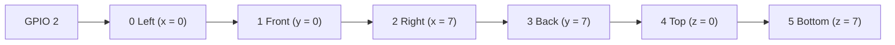
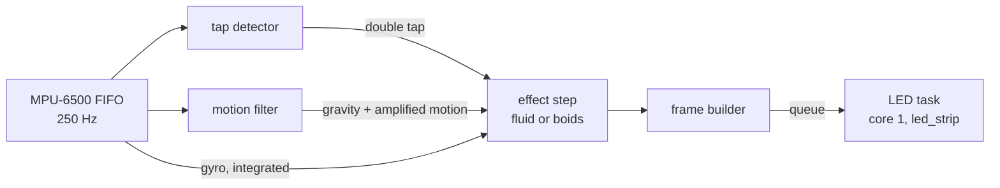

# Gravity Cube (ESP-IDF)

Firmware for an 8x8x8 LED cube whose particles fall the way the cube is
tilted. Tilt it and the fluid flows downhill; shake it and the fluid
sloshes; spin it and the fluid swirls against the spin and out to the
walls. A double tap switches to a flock of boids and back.

It runs on a plain ESP32 with an MPU-6500 IMU and six 8x8 WS2812 panels,
and is written in C for ESP-IDF 6.1. The physics is a port of the fluid
solver in [gravity-cube-rs](https://github.com/psytraxx/gravity-cube-rs).

## Hardware

| Part | Notes |
|---|---|
| ESP32 dev board | Any plain ESP32 (dual core, 4 MB flash) |
| MPU-6500 breakout | 3–5 V supply (on-board LDO), wired for SPI |
| 6 × 8x8 WS2812B panels | 384 LEDs in one chain |
| 74AHCT125 | 3.3 V to 5 V level shifter for the LED data line |
| 330 Ω resistor | In series with the data line, at the first panel |
| 5 V supply | Sized for the LEDs; the firmware keeps them dim (one channel at 60/255 or less) |

## Wiring

### LEDs

| ESP32 | Goes to |
|---|---|
| GPIO 2 | 74AHCT125 input → 330 Ω → DIN of panel 0 |

GPIO 2 is WLED's default LED pin on the ESP32. It is also a strapping pin:
it must not be pulled high while the ESP32 resets into download mode,
which a level shifter input does not do.

The panels chain OUT to IN. Each has IN at its bottom-left and scans row
by row to OUT at its top-right:



The per-panel rotation and mirroring is in
[`main/core/panel.c`](main/core/panel.c).

### MPU-6500 (SPI)

| MPU-6500 board | ESP32 |
|---|---|
| VCC | 3V3 (or 5 V) |
| GND | GND |
| SCL (SCLK) | GPIO 18 |
| SDA (SDI / MOSI) | GPIO 23 |
| AD0 (SDO / MISO) | GPIO 19 |
| NCS | GPIO 5 |

SPI runs at 1 MHz, against 400 kHz for the board's I2C interface, so a
frame's FIFO read takes a fraction of the time. The pins are settable in
menuconfig.

### Mounting

The IMU board lies flat on the top face with its Z axis pointing up and
its X axis along the cube's x axis. Mounted any other way, edit
`MPU6500_AXIS_MAP` in [`main/core/mpu6500_decode.h`](main/core/mpu6500_decode.h):
if tilting moves the fluid the wrong way on an axis, flip that axis' sign.

## Build and flash

ESP-IDF 6.1 ([install guide](https://docs.espressif.com/projects/esp-idf/en/v6.1/esp32/get-started/)):

```bash
idf.py set-target esp32   # once
idf.py build
idf.py -p /dev/ttyUSB0 flash monitor
```

Keep the cube still for the first second after reset: the gyro
calibrates its zero offset then.

The monitor logs a status line every 100 frames: effect, acceleration,
rotation rate, and the physics, frame and LED send times.

## Settings

`idf.py menuconfig` → *Gravity cube*:

| Setting | Default | |
|---|---|---|
| LED data GPIO | 2 | |
| Physics step period | 12 ms | The physics constants are per step; 12 ms is the LED chain's refresh time |
| Tap threshold | 1000 mg | Raise it if sloshing switches effects, lower it if taps are missed |
| IMU SPI pins | 23, 19, 18, 5 | MOSI, MISO, SCLK, CS |

Particle counts and colours are in [`main/core/config.h`](main/core/config.h).

## How it works



**Core 0** reads every IMU sample since the last frame, runs one physics
step and builds the frame. **Core 1** sends frames to the LEDs with
Espressif's [led_strip](https://components.espressif.com/components/espressif/led_strip)
component over RMT (~11.5 ms for 384 LEDs); the two overlap, and core 0 only waits if core 1
is still sending. Unchanged frames are not re-sent, so a settled cube
keeps the data line quiet.

**IMU.** The MPU-6500 samples accelerometer (±4 g) and gyro (±1000 °/s)
at 250 Hz into its FIFO. Each frame uses the mean acceleration and the
gyro integrated over all samples since the last frame.

**Motion filter.** A complementary filter tracks gravity: the gyro turns
the estimate as the cube tilts, and the accelerometer slowly corrects it.
Whatever acceleration is left over is the cube's own motion, and is
tripled before reaching the fluid, so shaking sloshes it but tilting does
not overshoot.

**Double tap.** The MPU-6500 has no tap engine outside its DMP, so taps
are found in software on the raw samples: a jump of more than the
threshold between two samples, after at least 30 ms of stillness, counts
as a tap; a second tap within 375 ms switches the effect. Shaking never
has the stillness, so it does not switch.

**Fluid.** Particles have continuous positions. Each step integrates
velocity, moves every particle, then pushes overlapping particles apart in
four solver passes on a spatial grid. Velocity is then the distance
actually moved, so a pile blocked by the walls comes to rest. A
particle's LED only moves once the particle is more than 0.65 cells from
its cell's centre, so a settled pile does not flicker. Spinning the cube
makes the fluid lag against the spin and flings it outwards.

**Boids.** 32 boids follow separation, alignment and cohesion, are blown
by tilt, and are swept round when the cube spins.

## Code layout

| Path | |
|---|---|
| `main/main.c` | Main loop on core 0, LED task on core 1 |
| `main/mpu6500.c` | MPU-6500 over SPI: setup, gyro calibration, FIFO reads |
| `main/ws2812.c` | WS2812 chain through the `espressif/led_strip` component (RMT) |
| `main/core/` | Everything that needs no hardware: effects, motion filter, tap detector, panel map, IMU sample decoding |
| `test/host/` | Unity tests for `main/core`, run on the host |

## Tests

The core has host tests (plain CMake and Unity, no ESP-IDF):

```bash
cmake -S test/host -B build-host && cmake --build build-host
ctest --test-dir build-host --output-on-failure
```

CI runs them and builds the firmware on every push.
