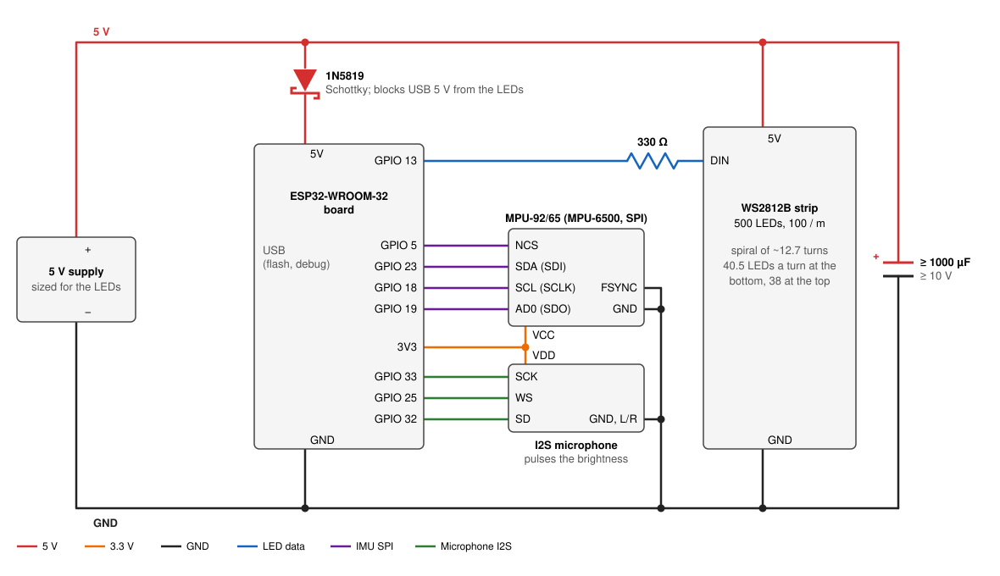
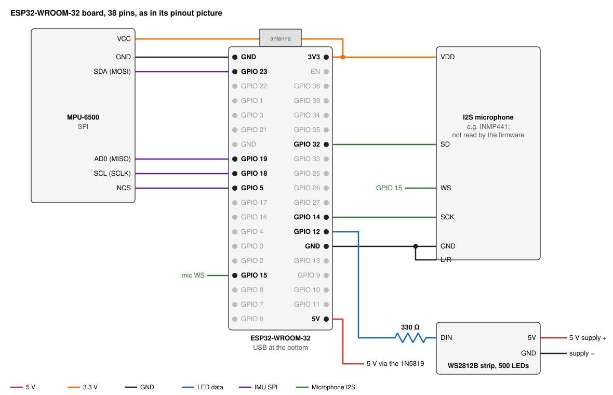
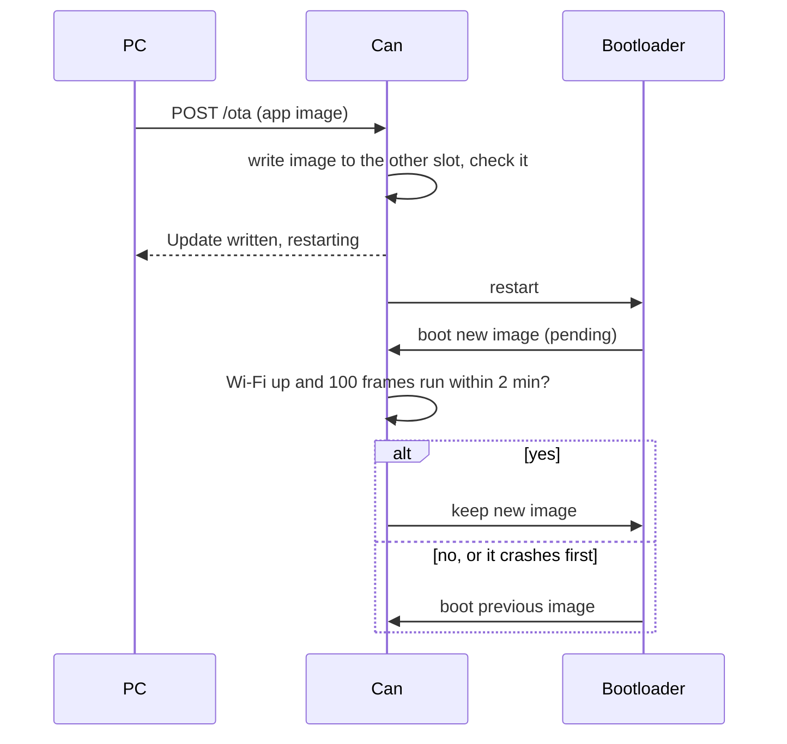
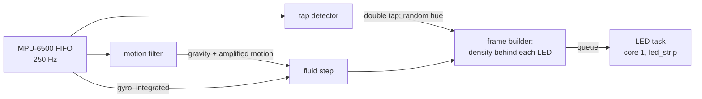

# Gravity can (ESP-IDF)

Firmware for a can of light: a WS2812B strip wound in a spiral round a
slightly conical cylinder shows the liquid inside it. Tilt the can and the surface tilts;
shake it and the fluid sloshes; lay it on its side and the fluid runs
along the low side. A double tap gives the fluid a new, random colour.

It runs on an ESP32-WROOM-32 with an MPU-6500 IMU, and is written in C
for ESP-IDF 6.1. The physics is a port of the fluid solver in
[gravity-cube-rs](https://github.com/psytraxx/gravity-cube-rs).

## Hardware

| Part | Notes |
|---|---|
| ESP32-WROOM-32 board | 4 MB flash |
| MPU-6500 breakout | 3–5 V supply (on-board LDO), wired for SPI |
| WS2812B strip, 500 LEDs | 100 per metre, wound in a spiral of about 12.7 turns (13 rows) round the can, each turn the same way round: about 40.5 LEDs a turn at the bottom, 38 at the top |
| I2S microphone (e.g. INMP441) | On GPIO 14, 15 and 32; wired, but the firmware does not read it |
| 330 Ω resistor | In series with the data line, at the strip's input |
| 1000 µF capacitor or more | Across 5 V and GND at the strip's input (10 V or more) |
| 1N5819 Schottky diode | From the 5 V supply to the board's 5V pin, so USB cannot feed the strip or the supply |
| 5 V supply | Sized for the LEDs; the firmware keeps them dim (one channel at 60/255 or less) |

## Wiring



On the board's pins (a 38-pin ESP32-WROOM-32 board, its pins as printed
in its pinout picture):



### Power

The 5 V supply feeds the strip directly and the board through the
1N5819, anode on the supply, cathode (the band) on the board's 5V pin.
As a Schottky it drops about 0.3 V. With USB plugged in as well, the
diode keeps USB's 5 V out of the supply and the strip; the board then
runs from whichever is higher. The capacitor sits across 5 V and GND
where the supply meets the strip, + to 5 V. All grounds are common.

### LEDs

| ESP32 | Goes to |
|---|---|
| GPIO 12 | 330 Ω → DIN of the strip |

GPIO 12 is a strapping pin: high at reset, it selects 1.8 V flash and
the board does not boot. The strip's input does not pull it up, so it
stays low; if the board fails to boot with the strip connected, move the
data line to a free pin such as GPIO 27 and set it in menuconfig.

The ESP32 drives the data line at 3.3 V; WS2812B LEDs want about 3.5 V
at a 5 V supply. Most take 3.3 V; if the first LEDs flicker or show
wrong colours, add a 74AHCT125 level shifter.

### MPU-6500 (SPI)

The IMU uses the ESP32's VSPI pins, together on one side of the board:

| MPU-6500 board | ESP32 |
|---|---|
| VCC | 3V3 |
| GND | GND |
| SCL (SCLK) | GPIO 18 (VSPI CLK) |
| SDA (SDI / MOSI) | GPIO 23 (VSPI MOSI) |
| AD0 (SDO / MISO) | GPIO 19 (VSPI MISO) |
| NCS | GPIO 5 (VSPI CS) |

SPI runs at 1 MHz, against 400 kHz for the board's I2C interface, so a
frame's FIFO read takes a fraction of the time. The pins are settable in
menuconfig. GPIO 5 is a strapping pin that has to be high at boot; NCS
idles high, so it is.

### I2S microphone

| Microphone board | ESP32 |
|---|---|
| VDD | 3V3 |
| GND | GND |
| SCK | GPIO 14 (I2S bit clock) |
| WS | GPIO 15 (I2S word select) |
| SD | GPIO 32 (I2S data) |
| L/R | GND (left channel) |

The firmware does not read the microphone. These are the pins WLED's
sound-reactive build uses on this can (`"digitalmic": {"type": 1,
"pin": [32, 15, 14, -1]}`: SD, WS, SCK, no MCLK). GPIO 15 is a strapping
pin that only silences the boot messages when low, so the microphone's
WS line on it does no harm.

### The strip and the IMU

The strip's geometry is in [`main/core/config.h`](main/core/config.h):
500 LEDs, the data entering at the bottom and the strip winding
counter-clockwise seen from above. Measure the can and set:

| Setting | Default | |
|---|---|---|
| `CAN_LEDS_PER_TURN_BOTTOM` | 40.5 | LEDs in the bottom turn |
| `CAN_LEDS_PER_TURN_TOP` | 38.0 | LEDs in the top turn |
| `CAN_LED_SPACING_MM` | 10.0 | Distance between two LEDs along the strip (100 LEDs per metre) |
| `CAN_ROW_PITCH` | 1.2 | Distance between two turns, divided by the LED spacing |
| `CAN_START_AT_TOP` | 0 | 1 if the data enters at the top turn |
| `CAN_CLOCKWISE` | 0 | 1 if the strip winds clockwise seen from above |

The LEDs per turn change evenly from bottom to top; with 500 LEDs that
makes about 12.7 turns. The can's radius at each height follows from its
LEDs per turn there.

The grid round the can (`FLUID_NX`, `FLUID_NY`, `FLUID_NZ`) has to hold
it: the host tests check, and say so if a new row pitch needs a taller
grid.

The IMU board lies flat on the can's lid or floor with its Z axis
pointing up and its X axis pointing at LED 0, which the LED test shows
(below). Mounted any other way, edit `MPU6500_AXIS_MAP` in
[`main/core/mpu6500_decode.h`](main/core/mpu6500_decode.h): if tilting
moves the fluid the wrong way on an axis, flip that axis' sign. If the
fluid is mirrored (tilting towards one side raises the fluid on the
other), the strip winds the other way: flip `CAN_CLOCKWISE`.

### Calibration picture

For setting all this up, turn on *Calibration picture instead of the
fluid* in menuconfig. After the LED test the can shows, for good:

- four coloured lines up the can, one LED per turn each: red at LED 0's
  angle (the IMU's +X), then green, blue and yellow a quarter turn apart.
  Straight lines mean the LEDs per turn are right; red, green, blue,
  yellow counter-clockwise seen from above means the winding direction
  is. A line leaning one way means too few LEDs per turn at that end,
  the other way too many.
- a white band, while the can tilts, on its low side: where the fluid
  would run. If it lights the opposite side on one axis, flip that axis
  in `MPU6500_AXIS_MAP`.

The monitor logs the acceleration and the low side's angle every 100
frames. Updates over Wi-Fi keep working while it runs.

## Build and flash

ESP-IDF 6.1 ([install guide](https://docs.espressif.com/projects/esp-idf/en/v6.1/esp32/get-started/)):

```bash
idf.py build
```

```bash
idf.py -p /dev/ttyUSB0 flash monitor
```

At power on, before the fluid starts, the strip fills green from the
data input, five LEDs at a time (about 2 s): a dark LED, or every LED from one
point on, shows a dead LED or a broken strip. Then one LED per turn
lights, the one nearest LED 0's angle, for 2 s. They make a straight
line up the can if the LEDs per turn are right; a line that leans means
they are off. The line also marks where the IMU's X axis has to
point.

Keep the can still from the end of the LED test until a second later:
the gyro calibrates its zero offset then.

The monitor logs a status line every 100 frames: acceleration,
rotation rate, and the physics, frame and LED send times.

## Updates over Wi-Fi

Once the can has been flashed over USB with a Wi-Fi SSID set, it takes
new firmware over the network. Set the SSID and password (and, ideally,
an update token) in `idf.py menuconfig` → *Gravity can* → *Wi-Fi and
firmware updates*, flash over USB once, then for every update:

```bash
idf.py build
```

```bash
curl -H "Authorization: Bearer $TOKEN" \
     --data-binary @build/gravity-can.bin http://can.local/ota
```

`curl http://can.local/` shows the running version (from `git
describe`) and app slot. If `can.local` does not resolve, use the IP
address the monitor logs once Wi-Fi is up.



The 4 MB flash has two 1984 KB app slots ([`partitions.csv`](partitions.csv)):
the running firmware writes the new image into the other one and boots
it. A new image only stays if it gets onto the network and runs the main
loop for 100 frames within two minutes; if not, or if it crashes first,
the bootloader goes back to the previous image. So a broken build cannot
cut the can off from further updates, but one built with no SSID turns
updates off for good, until the next USB flash.

Wi-Fi, the network stack and the update server run on core 1, next to
the LED task, so the physics on core 0 keeps its time. Flash writes
pause both cores for moments at a time, so the fluid stutters for the
few seconds an update takes.

Without a token, anyone on the network can reflash the can.

## Settings

`idf.py menuconfig` → *Gravity can*:

| Setting | Default | |
|---|---|---|
| LED data GPIO | 12 | |
| Physics step period | 18 ms | The physics constants are per step |
| LED test at power on | on | Fills the strip, then shows LED 0's line up the can (~4 s) |
| Calibration picture | off | Instead of the fluid: lines for the geometry, a band for the IMU |
| Tap threshold | 1000 mg | Raise it if sloshing changes the colour, lower it if taps are missed |
| IMU SPI pins | 23, 19, 18, 5 | MOSI, MISO, SCLK, CS |
| I2C scan at startup | off | Wiring check: probes the IMU pins as I2C; finds the MPU-6500 at 0x68/0x69 after a power on |
| Wi-Fi SSID, password | empty | Network for updates over Wi-Fi; an empty SSID turns Wi-Fi off |
| Hostname | can | Answers at `http://can.local/` |
| Update token | empty | Updates need `Authorization: Bearer <token>`; empty lets anyone on the network update |

The strip's geometry and the fluid's colour are in
[`main/core/config.h`](main/core/config.h).

## How it works



**Core 0** reads every IMU sample since the last frame, runs one physics
step and builds the frame. **Core 1** sends frames to the strip with
Espressif's [led_strip](https://components.espressif.com/components/espressif/led_strip)
component over RMT (~15 ms for 500 LEDs); the two overlap, and core 0
only waits if core 1 is still sending. Unchanged frames are not re-sent,
so a settled can keeps the data line quiet.

**IMU.** The MPU-6500 samples accelerometer (±4 g) and gyro (±1000 °/s)
at 250 Hz into its FIFO. Each frame uses the mean acceleration and the
gyro integrated over all samples since the last frame.

**Motion filter.** A complementary filter tracks gravity: the gyro turns
the estimate as the can tilts, and the accelerometer slowly corrects it.
Whatever acceleration is left over is the can's own motion, and is
tripled before reaching the fluid, so shaking sloshes it but tilting does
not overshoot.

**Double tap.** The MPU-6500 has no tap engine outside its DMP, so taps
are found in software on the raw samples: a jump of more than the
threshold between two samples, after at least 30 ms of stillness, counts
as a tap; a second tap within 375 ms picks a random hue at least 60°
from the current one. Shaking never has the stillness, so it does not
change the colour. Every hue's channels add up to 60/255, so the strip
draws the same current in any colour.

**Fluid.** An incompressible FLIP fluid: inviscid Navier-Stokes on a
staggered grid of 8 × 8 × 10 cells, each 1.75 LED spacings across
(coarser cells would look blockier, finer ones cost too much time on an
ESP32). The can is the cells whose centres lie within its radius at
their height: 44 per layer at the bottom, 32 near the top, so it is as
round, and narrows as it climbs, as far as cells that size allow; its
walls are their outer faces. Faces with no cell of the can on either
side take no part, as faces beyond the grid's edge do. Each step the
particles take gravity and the forces of the turning can (Euler,
Coriolis, centrifugal), hand their velocity to the grid, and a
Gauss-Seidel pressure solve (60 passes) makes the flow divergence-free
against the walls. The particles take back the change (80 % FLIP, 20 %
PIC to damp noise), move, and are pushed apart so they stay evenly
spread; cells packed above two particles get a little outflow, so the
fluid keeps its volume. About 440 particles fill the bottom half.

A can is closed and narrow, so shoving it sideways only presses on the
fluid: it moves where it has a free surface to move into. Spun about
its axis, the fluid mostly stays put while the can turns round it, as
liquid in a glass does at first.

**LEDs.** Each LED's place on the spiral follows from its index: the
LEDs per turn change evenly from 40.5 at the bottom to 38 at the top, so
LED *i* sits where the LEDs counted so far reach *i*, and on the circle
of the can's radius at that height. It shows the fluid half a cell
inside the wall in front of it, blended from the nearest cell centres:
it lights once the density there reaches 1.0 and goes dark below 0.4, so
a still surface does not flicker. Because the spiral climbs a little
with every LED, a tilted surface shows as a smooth slanted line rather
than steps.

## Code layout

| Path | |
|---|---|
| `main/main.c` | Main loop on core 0, LED task on core 1, LED test, calibration picture |
| `main/ota.c` | Wi-Fi, mDNS and the update server on core 1; keeps or rolls back a new image |
| `main/mpu6500.c` | MPU-6500 over SPI: setup, gyro calibration, FIFO reads |
| `main/ws2812.c` | The strip through the `espressif/led_strip` component (RMT) |
| `main/core/` | Everything that needs no hardware: fluid, LED spiral and calibration picture, colours, motion filter, tap detector, IMU sample decoding |
| `test/host/` | Unity tests for `main/core`, run on the host |

## Tests

The core has host tests (plain CMake and Unity, no ESP-IDF):

```bash
cmake -S test/host -B build-host && cmake --build build-host
```

```bash
ctest --test-dir build-host --output-on-failure
```

CI runs them and builds the firmware on every push to this branch.
