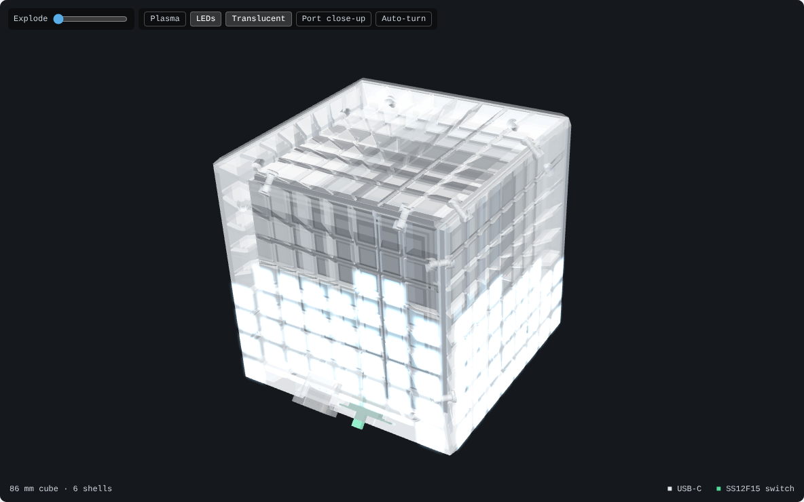
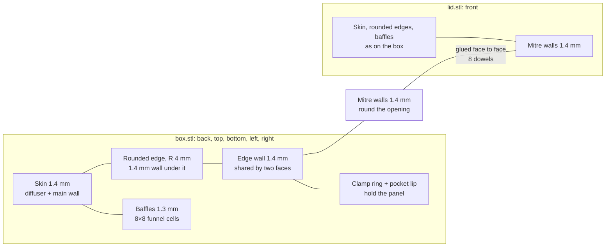

# Voxel Skin enclosure



A translucent resin cube whose six faces each hold one WS2812 8×8 panel. Five faces print as one open **box**; the front face is the **lid**. It comes in two sizes from the same generator:

| | `65x65/` | `80x80/` |
|---|---|---|
| Panel | rigid 65 × 66 mm, 8.125 mm pitch | flexible 80 × 80 mm, 10 mm pitch, on a 1 mm backing sheet |
| Outer cube | **86.0 mm** | **100.0 mm** |
| Resin | 124 cm³ (box 102.7 + lid 21.5) | 155 cm³ (box 128.4 + lid 26.7) |
| Lit width per face | 79.2 mm | 93.2 mm |
| Pocket clearance per side | 0.25 mm | 0.4 mm |

View it in 3D: <https://psytraxx.github.io/gravity-cube-espidf/voxel-skin/viewer.html> (add `?p=80x80` for the larger cube).

## Design



Every face is a folded plate of constant thickness. The outer skin, the rounded edges and the edge walls are one continuous **1.4 mm** wall, and this wall carries the load. All twelve edges are rounded to a 4 mm radius and the corners are spherical; under every rounding the light cells keep 1.4 mm away from the surface. The eight edges inside the box are a single 1.4 mm wall shared by the two faces, so the box is one stiff monolithic part. Along the four edges of the opening, the box and the lid each have a 1.4 mm mitre wall; they lie face to face over their whole width (about 10 mm) and form the only glue joint.

Inside the skin, **1.3 mm** baffles split the light into 8×8 funnel cells. Each baffle is a strip of constant thickness, bent just above the LEDs: square to the face beside them, then sloping out to its place on the skin. As on a bent strip, the face on the inside of the bend starts to slope a little lower than the other, so the baffle stays 1.3 mm thick through the bend; the bend is placed so that this stays above the LEDs. The outermost cells run out to the edge walls, which reflect their light, so the pixels reach almost to the rounded edges and no solid material runs along the edges.

The panel sits in a pocket with a short lip at its edge. A clamp ring rests on the panel margin, outside the LEDs and the capacitors; the baffles stop 1.3 mm above the panel. The panel backs sit 1.2 mm inside the neighbouring panel edges.

Two 2 mm dowels cross each mitre between box and lid. Each hole sits in a small boss at the root of the mitre wall, centred on the baffle between the outer two LED columns and clear of the panel and the LEDs.

The USB-C socket and the SS12F15 switch sit on a flat pad along the middle of the bottom front edge: a 45° flat cut 2.5 mm into the rounding (about 4.9 mm wide), split between the box and the lid. They point diagonally into the wedge between the front and bottom panels. Above them the outermost cells stop short of the edge (columns 1–6 on the 65 mm cube, 2–5 on the 80 mm cube), leaving solid resin for the pockets. The leads pass between the two panel corners into the cube; with centred panels that slot is 1.7 mm wide.

### Wall rules

`check_fit.py` checks two rules on every printed STL:

- every outer wall (surfaces on the outside of the cube or on a mitre) and every edge wall is at least **1.3 mm** thick, measured to the nearly parallel face behind it;
- every feature is at least **0.8 mm** thick, counting wedges up to 45°.

The thinnest outer wall is 1.37 mm (beside the port pockets). The thinnest features are the 0.9 mm walls around the dowel holes.

| Dimension | 65x65 | 80x80 |
|---|---|---|
| Skin, rounded edges, edge and mitre walls | 1.4 | 1.4 |
| Baffles | 1.3 | 1.3 |
| LED to baffle (centred grid) | 0.91 | 1.85 |
| Top of the LEDs to the skin | 4.2 | 4.2 |
| Panel back to the neighbouring panel edge | 1.2 | 1.2 |
| Clamp ring on the panel margin | 0.6 | 0.6 |
| Edge radius | 4 | 4 |
| Port pad depth (from the sharp edge) | 2.5 | 2.5 |

## Files

Each profile folder holds:

| File | Qty | Purpose |
|---|---|---|
| `box.stl` | 1 | Back, top, bottom, left and right faces in one part, open at the front; in cube coordinates |
| `lid.stl` | 1 | Front face, with the USB-C cut-out and switch slot (the bottom face holds the other half) |
| `fit_test.stl` | optional | Pocket lip and clamp ring of one face; order it first to check that a real panel seats in its pocket |
| `part_*.stl` | – | USB-C socket and switch reference models, in cube coordinates (not printed) |
| `profile.json` | – | Dimensions the viewer reads |

`generate.py` builds every file, `check_fit.py` runs the fit and wall checks, and `viewer.html` shows either profile.

**Material:** translucent or clear resin (SLA) for both parts. Sand or bead-blast the outside for an even frosted glow. Supports go on the baffle edges and clamp rings, which face the inside of the cube; on the box they stand inside it. Every cell is open to the inside and the box is open at the front, so no resin is trapped. The box needs a printer or print service that takes a part of the full cube size.

## Bought parts

| Qty | Part |
|---|---|
| 6 | WS2812 8×8 panel: rigid 65 × 66 × 1.6 mm, or flexible 80 × 80 mm |
| 6 | 80 × 80 mm only: backing sheet 80 × 80 × 1 mm (aluminium, FR4 or acrylic) |
| 1 | Snap-in USB-C socket with leads: flange 15.8 × 8.2 × 2.0, body 12.2 × 5.2, snap wings 15.6 across |
| 1 | SS12F15 slide switch: plate 19.6 × 5.5, body 11.5 × 5.5 × 5.0, lugs 7.8 deep |
| 8 | 2 mm dowel, about 5.5 mm long (1.75 mm filament works) |

A flexible panel will not stay flat on its own: glue it to its backing sheet with thin double-sided tape or a thin layer of glue. The pocket takes a 1.6 mm stack (flexible PCB, adhesive and the 1 mm sheet). If your stack differs, change `PCB_T` and rebuild.

`USB_CUTOUT` follows the supplier drawing (14.2 × 5.4 panel cut-out). If your socket differs, measure it and change `USB_BODY` and `USB_CUTOUT` before ordering.

## Assembly

1. Fit the back panel first, straight in through the open front, LEDs towards the baffles. A few dots of glue on the clamp ring hold it.
2. Fit the four side panels. Hold each one parallel to its face and about 3.3 mm in from it, LEDs outwards, slide it in through the opening until it lines up with its pocket, then press it out into the pocket. `check_fit.py` checks this path against the box and the panels already in place. On the 65 mm cube the 66 mm side runs along the long side of each pocket.
3. Glue the switch behind its slot in the bottom face and wire the panels, ESP32 and battery inside the box.
4. Press the front panel into the lid, put the dowels in the box's mitre holes and close the lid. Push the USB-C socket into the port pad from outside; its pocket is split between box and lid. Glue the lid along its mitres, or leave it dry-fitted so the cube can be opened again (take the USB-C socket out first).

The edge walls are translucent, so some light passes from the edge cells of one face into the next. Along the lid, painting the mitre faces white or black before gluing stops it; inside the box the edge walls are shared, so a little bleed stays.

## Rebuilding

```bash
cd case/voxel-skin
pip install manifold3d trimesh numpy rtree scipy shapely
python3 generate.py                        # 65x65/
VOXEL_PROFILE=80x80 python3 generate.py    # 80x80/
python3 check_fit.py                       # must end with "All checks passed."
VOXEL_PROFILE=80x80 python3 check_fit.py
```

All dimensions are constants at the top of `generate.py`.

To view the STLs locally, serve the `case/` folder (browsers will not load STL files from `file://`):

```bash
cd case && python3 -m http.server 8000
# open http://localhost:8000/voxel-skin/viewer.html
```
