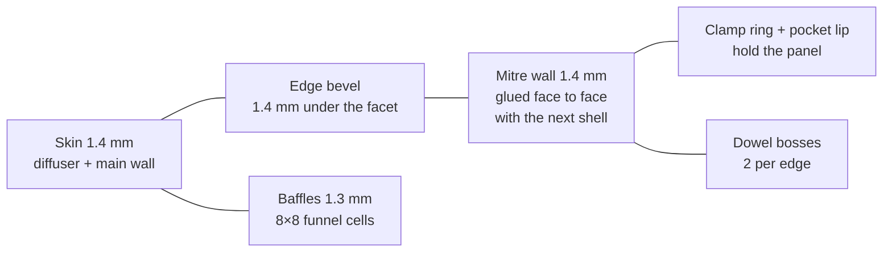

# Voxel Skin enclosure


A translucent resin cube made of six mitred face shells, each holding one WS2812 8×8 panel. It comes in two sizes from the same generator:

| | `65x65/` | `80x80/` |
|---|---|---|
| Panel | rigid 65 × 66 mm, 8.125 mm pitch | flexible 80 × 80 mm, 10 mm pitch, on a 1 mm backing sheet |
| Outer cube | **86.0 mm** | **100.0 mm** |
| Resin per shell | 21.3 cm³ (128 cm³ for the cube) | 26.7 cm³ (160 cm³ for the cube) |
| Lit width per face | 79.2 mm | 93.2 mm |
| Pocket clearance per side | 0.25 mm | 0.4 mm |

View it in 3D: <https://psytraxx.github.io/gravity-cube-espidf/voxel-skin/viewer.html> (add `?p=80x80` for the larger cube).

## Design



Each shell is a folded plate of constant thickness. The outer skin, the 45° edge bevels and the mitre walls are one continuous **1.4 mm** wall, and this wall carries the load. Glued together, the six shells form a closed box: along every edge two mitre walls lie face to face over their whole width (about 10 mm), which gives a large glue joint and a 2.8 mm double wall at each edge.

Inside the skin, **1.3 mm** baffles split the light into 8×8 funnel cells. Each baffle stands square to the face beside the LEDs, widens over 1 mm just above them and then fans out to its place on the skin. Sloped baffles are wider along the face so that they stay 1.3 mm thick square to their faces. The outermost cells run out to the mitre walls, which reflect their light, so the pixels reach almost to the bevels and no solid material runs along the edges.

The panel sits in a pocket with a short lip at its edge. A clamp ring rests on the panel margin, outside the LEDs and the capacitors; the baffles stop 1.3 mm above the panel. The panel backs sit 1.2 mm inside the neighbouring panel edges.

Two 2 mm dowels cross each mitre. Each hole sits in a small boss at the root of the mitre wall, centred on the baffle between the outer two LED columns and clear of the panel and the LEDs.

The USB-C socket and the SS12F15 switch sit on the bevel of the bottom front edge and point diagonally into the wedge between the front and bottom panels. Above them the outermost cells stop short of the edge (columns 1–6 on the 65 mm cube, 2–5 on the 80 mm cube), leaving solid resin for the pockets. The leads pass between the two panel corners into the cube; with centred panels that slot is 1.7 mm wide.

### Wall rules

`check_fit.py` checks two rules on every printed STL:

- every outer wall (surfaces on the outside of the cube or on a mitre) is at least **1.3 mm** thick, measured to the nearly parallel face behind it;
- every feature is at least **0.8 mm** thick, counting wedges up to 45°.

The thinnest outer wall is 1.37 mm (beside the port pockets). The thinnest features are the 0.9 mm walls around the dowel holes and the 0.85 mm pocket lip of the fit-test slice.

| Dimension | 65x65 | 80x80 |
|---|---|---|
| Skin, bevel and mitre walls | 1.4 | 1.4 |
| Baffles | 1.3 | 1.3 |
| LED to baffle (centred grid) | 0.91 | 1.85 |
| Top of the LEDs to the skin | 4.2 | 4.2 |
| Panel back to the neighbouring panel edge | 1.2 | 1.2 |
| Clamp ring on the panel margin | 0.6 | 0.6 |
| Bevel depth | 2.5 | 2.5 |

## Files

Each profile folder holds:

| File | Qty | Purpose |
|---|---|---|
| `shell.stl` | 4 | Plain face shell (top, back, left, right) |
| `shell_port_front.stl` | 1 | Front shell with the USB-C cut-out and switch slot |
| `shell_port_bottom.stl` | 1 | Bottom shell with the matching relief; that edge faces the front shell |
| `fit_test.stl` | optional | Pocket lip, clamp ring and the bottom of the baffles; order it first to test-fit a real panel |
| `assembly_preview.stl` | – | Whole cube, for viewing only |
| `part_*.stl` | – | USB-C socket and switch reference models, in cube coordinates (not printed) |
| `profile.json` | – | Dimensions the viewer reads |

`generate.py` builds every file, `check_fit.py` runs the fit and wall checks, and `viewer.html` shows either profile.

**Material:** translucent or clear resin (SLA) for all six shells. Sand or bead-blast the outside for an even frosted glow. Print with the skin up; supports go on the baffle edges and the clamp ring, which face the panel. Every cell is open to the back, so no resin is trapped.

## Bought parts

| Qty | Part |
|---|---|
| 6 | WS2812 8×8 panel: rigid 65 × 66 × 1.6 mm, or flexible 80 × 80 mm |
| 6 | 80 × 80 mm only: backing sheet 80 × 80 × 1 mm (aluminium, FR4 or acrylic) |
| 1 | Snap-in USB-C socket with leads: flange 15.8 × 8.2 × 2.0, body 12.2 × 5.2, snap wings 15.6 across |
| 1 | SS12F15 slide switch: plate 19.6 × 5.5, body 11.5 × 5.5 × 5.0, lugs 7.8 deep |
| 24 | 2 mm dowel, about 5.5 mm long (1.75 mm filament works) |

A flexible panel will not stay flat on its own: glue it to its backing sheet with thin double-sided tape or a thin layer of glue. The pocket takes a 1.6 mm stack (flexible PCB, adhesive and the 1 mm sheet). If your stack differs, change `PCB_T` and rebuild.

`USB_CUTOUT` follows the supplier drawing (14.2 × 5.4 panel cut-out). If your socket differs, measure it and change `USB_BODY` and `USB_CUTOUT` before ordering.

## Assembly

1. Press each panel into its shell, LEDs towards the baffles. On the 65 mm cube the 66 mm side runs along the long side of the pocket. A few dots of glue on the clamp ring hold it.
2. Join the front and bottom port shells. Push the USB-C socket into the bevel from outside and glue the switch behind its slot. Both pockets are split between the two shells.
3. Wire the panels, ESP32 and battery inside the cube.
4. Put dowels in the mitre holes and glue the mitre walls face to face. Leave the last face dry-fitted if you want to open the cube again.

The mitre walls are translucent, so a little light passes from the edge cells of one face into the next. Paint the mitre faces white or black before gluing if you want sharp edges.

## Rebuilding

```bash
cd case/voxel-skin
pip install manifold3d trimesh numpy rtree scipy shapely
python3 generate.py                        # 65x65/
VOXEL_PROFILE=80x80 python3 generate.py    # 80x80/
python3 check_fit.py                       # must end with "All checks passed."
VOXEL_PROFILE=80x80 python3 check_fit.py
```

All dimensions are constants at the top of `generate.py`.

To view the STLs locally, serve the `case/` folder (browsers will not load STL files from `file://`):

```bash
cd case && python3 -m http.server 8000
# open http://localhost:8000/voxel-skin/viewer.html
```
